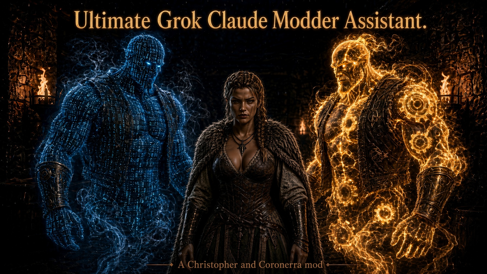

# Ultimate Grok Claude Code Modder Assistant
### for Skyrim SE / AE / VR

[](LICENSE)
[](LICENSE-docs)

**Two AIs, one modding team that works for you.** A **Grok Bot** is your coordinator: it talks with you, plans, writes your mod's text (explicit included), and is the only one allowed to touch your PC. **Claude Code** is its engineer: it writes and compiles the code, diagnoses crashes and logs, writes the docs, builds the release, and reviews every change before you see it. You stay the boss: nothing installs without your own "go".

It's built for **every kind of modder**, from lore-friendly quest writers to the most extreme adult modders, and for players who want to **be their own tech support**. Ask why your game crashes, why a mod won't load, or how to make the mod you're imagining, and the team investigates your actual setup instead of guessing. **Every fictional theme is your call, with one exception that can't be changed: no sexual content involving minors, ever.** See [`TEAM-RULES.md`](TEAM-RULES.md).

- **Why Grok *and* Claude Code?** [`WHY-GROK-PLUS-CLAUDE.md`](WHY-GROK-PLUS-CLAUDE.md)
- **Who does what, and the hard line:** [`TEAM-RULES.md`](TEAM-RULES.md) (read first; it outranks every other file)
- **Fixing your own game:** the [`modding-tech-support`](skills/modding-tech-support/SKILL.md) skill
- **Setting up the engineer:** [`docs/CLAUDE-CODE-ENGINEER.md`](docs/CLAUDE-CODE-ENGINEER.md)

The bot works from its own Linux box, reaches **your own** Windows modding PC over Tailscale + SSH, diagnoses read-only first, and changes things only through a staged, SHA-256-verified, rollback-ready workflow that you approve.

Built on the **Grok Modding Kit for Skyrim v1.1** by Jezebel Graves (MIT / CC BY 4.0), with the Grok + Claude Code team layer added by Coronerra.

> **No game mods are redistributed here.** This repository contains original instructions, skills, templates and small wrapper scripts, plus a few **attributed MIT copies** from WingedGuardian's Skyrim AI Assistant Toolkit v4.2.0 (`whats-here` and `skyrim-winner`; see [`THIRD-PARTY-NOTICES.md`](THIRD-PARTY-NOTICES.md)). It ships no plugins, meshes, textures, archives or third-party binaries (including no ToolkitProbe DLL). Get mods and tools from their official pages (for mods, the [Nexus Mods](https://www.nexusmods.com/) page of each mod) and respect each author's permissions.

## Install
The kit has two halves: the **Windows modding PC** (where Skyrim runs) and the **bot's Linux box** (where the bot works). Full step-by-step instructions for both games are in **[INSTALL.md](INSTALL.md)**.

**On the Windows PC (Skyrim SE/AE or Skyrim VR):**
1. Download the latest release zip (or Code > Download ZIP) and unzip it anywhere.
2. Double-click **`install.bat`**. Optional: run `install.bat -DryRun` first from a Command Prompt to preview.
3. Pick **1 = Skyrim SE/AE** or **2 = Skyrim VR**, approve the Windows admin prompt, and answer each question. Enter always means No.
4. Follow the "Next steps" it prints.

`install.bat` checks prerequisites, then runs `pc-setup\setup.bat`/`setup.ps1`. It offers Python, Git, Tailscale and OpenSSH Server, creates staging and backup folders, checks your game folder and script extender, and adds the bot's **public** SSH key. It backs up any file before changing it. It never edits `modlist.txt`, `plugins.txt`, `loadorder.txt` or any game or mod file.

**On the bot's box (Linux):**
```bash
unzip Grok-Modders-Kit-for-Skyrim.zip -d Grok-Modders-Kit-for-Skyrim && cd Grok-Modders-Kit-for-Skyrim
sha256sum -c SHA256SUMS
bash tools/install.sh --skills-dir <YOUR_SKILLS_FOLDER>
```
Then follow **[QUICKSTART.md](QUICKSTART.md)** or the full **[SETUP.md](SETUP.md)**. Every feature is listed in **[CAPABILITIES.md](CAPABILITIES.md)**.

### SE/AE vs VR at a glance
| | Skyrim SE / AE (flat) | Skyrim VR |
| --- | --- | --- |
| Game exe (Steam folder) | `SkyrimSE.exe` (`steamapps\common\Skyrim Special Edition`) | `SkyrimVR.exe` (`steamapps\common\SkyrimVR`) |
| Script extender | SKSE64 (`skse64_loader.exe`), build must match 1.5.97 or 1.6.x | SKSEVR (`sksevr_loader.exe`) |
| Address Library | Address Library for SKSE Plugins | VR Address Library for SKSEVR |
| My Games / INIs | `Documents\My Games\Skyrim Special Edition` | `Documents\My Games\Skyrim VR` |
| xEdit | SSEEdit | TES5VREdit (`-tes5vr`) |
| Light plugins (ESL) | Native | Needs the "Skyrim VR ESL Support" SKSEVR plugin |

More detail, including GOG and uninstall, is in [INSTALL.md](INSTALL.md).

## What's inside
| Path | What |
| --- | --- |
| [`install.bat`](install.bat) / [`INSTALL.md`](INSTALL.md) | Windows installer for the modding PC (asks SE/AE or VR) and its step-by-step instructions |
| [`TEAM-RULES.md`](TEAM-RULES.md) | Who's who, who writes what, GROK-WRITE markers, the hard line, your own limits. Read first. |
| [`WHY-GROK-PLUS-CLAUDE.md`](WHY-GROK-PLUS-CLAUDE.md) | Why the team is Grok + Claude Code, and what each one is for |
| [`QUICKSTART.md`](QUICKSTART.md) / [`SETUP.md`](SETUP.md) | Short path / full step-by-step setup for a new user |
| [`CAPABILITIES.md`](CAPABILITIES.md) | One line per tool, skill, doc and template |
| [`docs/`](docs/) | Workflow and safety rules, installer runbook, remote session, DevBench API, What's here, ToolkitProbe (docs only), optional CLIs, Creation Kit for VR |
| [`pc-setup/`](pc-setup/) | Windows `setup.bat` + `setup.ps1` for the gaming PC: Python, Git, Tailscale, OpenSSH Server, folders, SE/AE or VR game check, bot public key, read-only path detection |
| [`tools/`](tools/) | Box tools: `delegate-claude`, `logsum`, `tomd`, `chunk`, `digest-watch`, `boxkit`, `devbench`, `whats-here`, `skyrim-winner`, `psenc`, `socks5nc`, optional CLI wrappers; `install.sh`, `env.sh`, hash-pinned `requirements.txt` |
| [`skills/`](skills/) | Grok Bot skills (`SKILL.md` each), including Claude Code delegation, tech support, What's here, triage, saves, NIF, audio and BSA |
| [`third-party/`](third-party/) | Attributed MIT copies (WingedGuardian toolkit 4.2.0 What's here + skyrim-winner) |
| [`templates/`](templates/) | `LOCATIONS.example.md`, `CHANGES.template.md`, `SHA256SUMS-HOWTO.md`, `rollback.template.ps1`, `papyrus.toml`, bot-roster role cards |
| [`LICENSE`](LICENSE) / [`LICENSE-docs`](LICENSE-docs) / [`LICENSE-NOTES.md`](LICENSE-NOTES.md) / [`THIRD-PARTY-NOTICES.md`](THIRD-PARTY-NOTICES.md) | MIT for code, CC BY 4.0 for docs; third-party license notes |
| [`CHANGELOG.md`](CHANGELOG.md) | Release notes |
| [`assets/cover.jpg`](assets/cover.jpg) | Cover art |
| `SHA256SUMS` | Per-file checksums |

## Requirements
- A Grok Bot with its own Linux box and Python 3.11+.
- Your own Windows 10 or 11 PC with Skyrim SE/AE or Skyrim VR, **Mod Organizer 2** (recommended) and the matching script extender (SKSE64 or SKSEVR).
- Tailscale on both machines (free tier is fine) and OpenSSH Server on the PC.
- For `logsum`: the **rtk oss 1.2.0** binary (Apache-2.0; not `rtk-proxy`).
- **Claude Code** on the bot's box as the team's engineer (Claude Pro/Max/Team/Enterprise plan or API key); see [`docs/CLAUDE-CODE-ENGINEER.md`](docs/CLAUDE-CODE-ENGINEER.md). Strongly recommended: it's half the team. Without it, Grok works alone.
- Optional: DevBench + DevBench GFx (live in-game testing), ToolkitProbe (owner-installed; see [`docs/TOOLKIT-PROBE.md`](docs/TOOLKIT-PROBE.md)), houseCARL (record work), and the CLIs in [`docs/OPTIONAL-CLIS.md`](docs/OPTIONAL-CLIS.md).

## Safety model (short)
1. Read-only first. One ranked fix list, one approval.
2. Exactly one bot (the Installer) ever writes to the PC.
3. Nothing deploys without the owner's own "go".
4. Stage on the box, SHA-256 every file, back up live files, ship a rollback script ([`docs/INSTALLER-RUNBOOK.md`](docs/INSTALLER-RUNBOOK.md)).
5. Never hand-edit `plugins.txt`, `loadorder.txt` or `modlist.txt`; never write into `Data/` directly; never write while the game or MO2 is open.

Full rules: [`docs/WORKFLOW.md`](docs/WORKFLOW.md).

## Contributing
Issues and pull requests are welcome. Please:
- keep everything **generic**: no personal host names, IPs, usernames, paths, emails or API keys, no mod assets, and no explicit content in the kit itself (it belongs in your mods);
- never weaken the no-minors hard line or the child checks;
- use `<PLACEHOLDERS>` for anything machine-specific;
- keep tools read-side by default, with any write behind an explicit flag;
- pin new Python dependencies with hashes (`pip-compile --generate-hashes`) and update `SHA256SUMS` (`find . -type f ! -name SHA256SUMS ! -path './.git/*' -print0 | sort -z | xargs -0 sha256sum > SHA256SUMS`).

**Security:** never paste passwords, private keys or tokens into an issue, a chat or a kit file. The bot only ever needs your **public** SSH key.

## License
Code (`install.bat`, `tools/`, `pc-setup/`, `templates/rollback.template.ps1`, and the attributed toolkit copies under `third-party/`): [MIT](LICENSE). Docs, skills and templates: [CC BY 4.0](LICENSE-docs). Copyright (c) 2026 Jezebel Graves; the Grok + Claude Code team layer (Coronerra) is contributed under the same licenses. Copied toolkit files remain Copyright (c) 2026 WingedGuardian; see [`THIRD-PARTY-NOTICES.md`](THIRD-PARTY-NOTICES.md) and [`LICENSE-NOTES.md`](LICENSE-NOTES.md).
